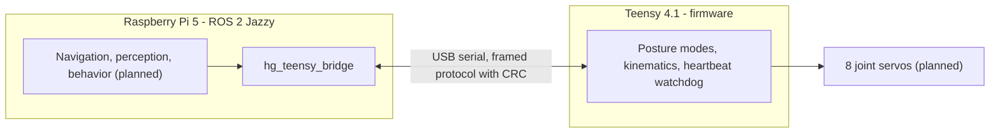

# Home Guardian

**An open-source quadruped robot for autonomous indoor home patrol, built on ROS 2.**

[](https://github.com/pkquy-vn/home-guardian-robot-dog/actions/workflows/firmware.yml)
[](https://github.com/pkquy-vn/home-guardian-robot-dog/actions/workflows/ros2.yml)
[](LICENSE)

> **Status: early development.** The real-time firmware, the Pi–Teensy link and the first ROS 2
> packages are in place. Servos, sensors and autonomy are not integrated yet.

## Overview

Home Guardian is an 8-DOF robot dog designed to patrol a home on its own. The goal is a robot
that maps the home, walks patrol routes, notices and records events, and returns to its dock to
charge. A Raspberry Pi 5 runs the high-level software on ROS 2 Jazzy. A Teensy 4.1 runs the
real-time control loop and the safety logic.

## Hardware

| Component | Details |
| --- | --- |
| Main computer | Raspberry Pi 5 (8 GB), NVMe SSD, Ubuntu Server 24.04, ROS 2 Jazzy |
| Real-time controller | Teensy 4.1, bare-metal firmware (PlatformIO) |
| Legs | 4 legs with 2 pitch joints each (hip, knee); femur 108 mm, tibia 130 mm |
| Frame | Derived from the open-source SpotMicro design |

## Architecture



The Pi sends commands and a 20 Hz heartbeat. The Teensy reports status and joint states, and falls
back to a safe posture if the heartbeat stops.

## Repository structure

```
firmware/     Teensy 4.1 firmware (PlatformIO) and host tests
ros2_ws/src/  ROS 2 packages: hg_teensy_bridge, hg_description, hg_bringup, hg_perception
common/       Code shared by the firmware and the Pi (serial protocol)
tools/        Pi-side utilities
docs/         Protocol, kinematics, setup guide, design decisions
cad/          Mechanical design and attribution
```

## Getting started

Prerequisites: a Raspberry Pi 5 with Ubuntu Server 24.04, ROS 2 Jazzy and PlatformIO Core, set
up as described in [docs/setup/raspberry-pi.md](docs/setup/raspberry-pi.md).

```bash
git clone https://github.com/pkquy-vn/home-guardian-robot-dog.git
cd home-guardian-robot-dog

# Build and flash the firmware (Teensy connected over USB)
pio run -d firmware -t upload

# Build and launch the ROS 2 packages
cd ros2_ws
source /opt/ros/jazzy/setup.bash
rosdep install --from-paths src --ignore-src -y
colcon build --symlink-install
source install/setup.bash
ros2 launch hg_bringup robot.launch.py
```

Run the host tests (no hardware needed):

```bash
python3 common/test/test_protocol.py
firmware/test_host/run_tests.sh
```

## Documentation

- [Serial protocol, posture modes and faults](docs/protocol.md)
- [Kinematics, reference poses and joint conventions](docs/kinematics.md)
- [ROS 2 bridge: topics, services and parameters](ros2_ws/src/hg_teensy_bridge/README.md)
- [Thermal camera driver (MLX90640)](ros2_ws/src/hg_perception/README.md)
- [Raspberry Pi setup](docs/setup/raspberry-pi.md)
- [Design decisions](docs/decisions/)

## Roadmap

- [x] Pi–Teensy serial protocol with CRC, cross-checked C++ and Python implementations
- [x] Posture modes (lie, sit, stand) with a latching heartbeat watchdog
- [x] Leg kinematics and smooth joint-level posture transitions
- [x] ROS 2 bridge, robot model (URDF) and CI builds
- [ ] Servo integration and calibration
- [ ] Walking gait
- [ ] IMU, foot contact and battery sensing
- [ ] Mapping, localization and navigation
- [ ] Autonomous docking and charging
- [ ] Perception, event detection and notifications
- [ ] Simulation

## Contributing

This project is in early development. Issues and suggestions are welcome. Commits follow
[Conventional Commits](https://www.conventionalcommits.org/).

## License

The code is licensed under the [Apache License 2.0](LICENSE). The mechanical design is derived
from the open-source SpotMicro project; its license and attribution are tracked in
[cad/README.md](cad/README.md).
